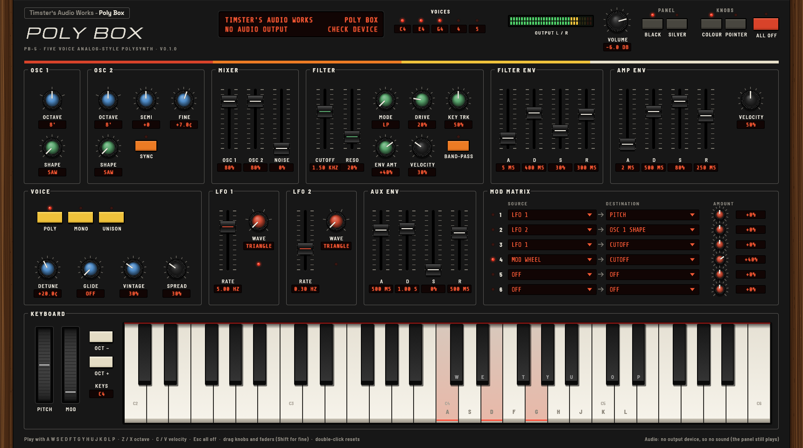

# Poly Box

A five-voice analog-style polysynth from Timster's Audio Works, after the sound of the Oberheim SEM: two VCOs per voice with a continuous saw-to-pulse shape and hard sync, the SEM's 12 dB state-variable filter sweeping low-pass through notch to high-pass, and (soon) an arpeggiator and a 64-step polyphonic sequencer.

For Linux, Windows and macOS, as a standalone app and a CLAP or VST3 plug-in.

An app with a hardware front panel (Linux, Windows and macOS), plus CLAP and VST3 plug-ins.



**Where it is:** five voices (poly, mono, unison), Vintage, glide, two LFOs, a modulation matrix and the front panel are done (steps 1, 2 and 4 of [ROADMAP.md](ROADMAP.md)). The arpeggiator and sequencer are next.

## Try it

```sh
cargo run --release --example render -- demo.wav     # hear it without an audio device
cargo run --release -p poly-box-app                  # the instrument: play it with A W S E D F T G Y H U J K O L P
cargo xtask bundle poly-box --release                # CLAP and VST3 plug-ins in target/bundled/
```

Poly Box isn't affiliated with Oberheim or Sequential; it's an original instrument in the spirit of the SEM.
